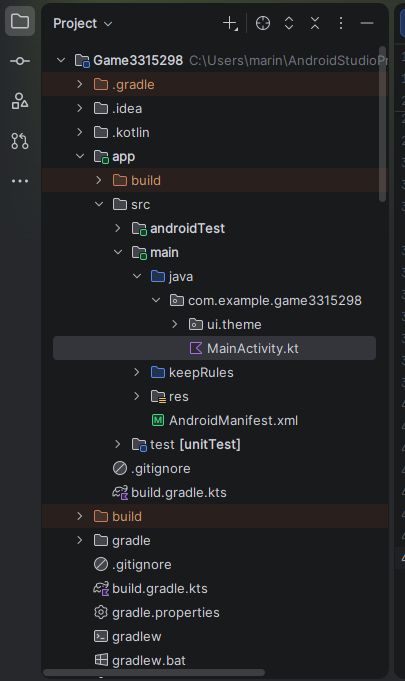
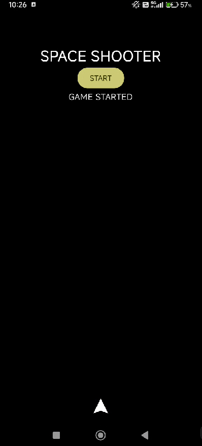

[regresar a **principal**](../principal.md)\
*22-10-2026*
# Configurar Android Studio
## Conectar celular USB


1. conectar celular por usb
2. run project
3. descargar app en celular
> para descargar la aplicacion debe activar las **opciones de desarrollador** del celular
> - activar **depuracion por USB**
> - activar **permisos para descargar por USB**
   
## Android studio:
configurar:
- cambiar **Android** a **Project**


> **MainActivity.kt** = archivo principal 

### permite texto:
```kotlin
import androidx.compose.material3.Text
```
```kt
@Composable
fun Greeting(name: String, modifier: Modifier = Modifier) {
    Text(
        text = "Hello $name!",
        modifier = modifier
    )
}
```

## Crear package
1. en *com.example.game33*
2. *click derecho*
3. **new**
4. **package**
5. nombrar "game"

## Crear clase
1. carpeta *game*
2. **new**
3. **kotlin class**
4. nombrar *GameScreen*
5. tipo **File**
6. enter

### En la clase:
```kt
package com.example.game3315298.game

import androidx.compose.runtime.Composable

// Create class
@Composable
fun GameScreen(){
    
}
```
> si se comenta en **español** marca **error**, pero **no es grave**

### Editar MainActivity.kt
```kt
class MainActivity : ComponentActivity() {
    override fun onCreate(savedInstanceState: Bundle?) {
        super.onCreate(savedInstanceState)
        enableEdgeToEdge()
        setContent {
            Game3315298Theme {
                // Agree the class before created
                GameScreen()
            }
        }
    }
}
```

### Importar y agregar en GameScreen
```kt
package com.example.game3315298.game

import androidx.compose.runtime.Composable
import androidx.compose.foundation.Canvas
import androidx.compose.foundation.layout.fillMaxSize
import androidx.compose.foundation.layout.Box
import androidx.compose.foundation.layout.Column
import androidx.compose.foundation.layout.padding
import androidx.compose.material3.Button
import androidx.compose.material3.Text
import androidx.compose.runtime.getValue
import androidx.compose.runtime.mutableStateOf
import androidx.compose.runtime.remember
import androidx.compose.runtime.setValue
import androidx.compose.ui.Alignment
import androidx.compose.ui.Modifier
import androidx.compose.ui.graphics.Color
import androidx.compose.ui.text.font.FontWeight
import androidx.compose.ui.unit.dp
import androidx.compose.ui.unit.sp

//Create class
@Composable
fun GameScreen(){
    var gameStarted by remember { mutableStateOf(false) }
    Box(modifier = Modifier.fillMaxSize()){
        Canvas(modifier = Modifier.fillMaxSize()) {
            drawRect(color = Color.Black)
        }
        Column(modifier = Modifier.fillMaxSize()
            .padding(top=100.dp),
            horizontalAlignment = Alignment.CenterHorizontally){
            Text(
                text = "SPACE SHOOTER",
                color = Color.White,
                fontSize = 28.sp,
                fontWeight = FontWeight.Bold
            )
            Button(onClick = { gameStarted = true}) {
                Text(text = "START")
            }
            if (gameStarted){
                Text(text = "GAME STARTED", color = Color.White)
            }
        }
    }
}
```
- Cambia la pantalla a azul
> "**Shift + F10**" Recarga el proyecto para visualizar

### Funciona por Coordenadas
las coordenadas de la pantalla de un celular inician *desde la parte superior izquierda* de la pantalla **(0, 0) - X, Y** <br>
depende de la resolucion del celular **"X = 1080, Y = 2400"** en muchos casos

### Crear nuevo file/class
Player.kt
```kt
package com.example.game3315298.game

data class Player(
    val x: Float,
    val y: Float
)
```

agregar en GameScreeen
```kt
val shipWith = 80f
            val shipHeight = 80f
            val playerX = size.width / 2
            val playerY = size.height - 120f
            val left = playerX - shipWith / 2
            val top = playerX - shipWith / 2
            val right = playerX - shipWith / 2
            val bottom = playerX - shipWith / 2
            val shipPath = Path().apply{
                moveTo(playerX, top)
                lineTo(left, bottom)
                lineTo(playerX, bottom-15f)
                lineTo(right, bottom)
                close()
            }
```
# Resultado final del dia:
```kt
package com.example.game3315298.game

import androidx.compose.ui.graphics.Path
import androidx.compose.runtime.Composable
import androidx.compose.foundation.Canvas
import androidx.compose.foundation.layout.fillMaxSize
import androidx.compose.foundation.layout.Box
import androidx.compose.foundation.layout.Column
import androidx.compose.foundation.layout.padding
import androidx.compose.material3.Button
import androidx.compose.material3.Text
import androidx.compose.runtime.getValue
import androidx.compose.runtime.mutableStateOf
import androidx.compose.runtime.remember
import androidx.compose.runtime.setValue
import androidx.compose.ui.Alignment
import androidx.compose.ui.Modifier
import androidx.compose.ui.graphics.Color
import androidx.compose.ui.input.pointer.pointerInput
import androidx.compose.ui.text.font.FontWeight
import androidx.compose.ui.unit.dp
import androidx.compose.ui.unit.sp
import androidx.compose.foundation.gestures.detectDragGestures
import androidx.compose.ui.layout.onSizeChanged

//Create class
@Composable
fun GameScreen(){
    var gameStarted by remember { mutableStateOf(false) }

    Box(modifier = Modifier.fillMaxSize()){
        var playerX by remember { mutableStateOf(0f) }
        var playerY by remember { mutableStateOf(0f) }
        var playerInitializer by remember { mutableStateOf(false) }
        var screenWidth by remember {mutableStateOf(0f)}
        Canvas(modifier = Modifier.fillMaxSize()
            .onSizeChanged { size ->
                screenWidth = size.width.toFloat()
                if (!playerInitializer){
                    playerX = size.width / 2f
                    playerY = size.height - 220f
                    playerInitializer = true
                }
            }
            .pointerInput(Unit){detectDragGestures (
                onDrag = {change, dragAmount ->
                    change.consume()
                    val shipWidth = 80f
                    playerX =( playerX + dragAmount.x )
                        .coerceIn(shipWidth/2,
                            screenWidth - shipWidth/2)
                }
            )}) {
            drawRect(color = Color.Black)
            val shipWith = 80f
            val shipHeight = 80f
            // val playerX = size.width / 2
            // val playerY = size.height - 220f
            val left = playerX - shipWith / 2
            val top = playerY - shipHeight / 2
            val right = playerX + shipWith / 2
            val bottom = playerY + shipHeight / 2
            val shipPath = Path().apply{
                moveTo(playerX, top)
                lineTo(left, bottom)
                lineTo(playerX, bottom - 15f)
                lineTo(right, bottom)
                close()
            }
            drawPath(shipPath, color = Color.White)
        }
        Column(modifier = Modifier.fillMaxSize()
            .padding(top=100.dp),
            horizontalAlignment = Alignment.CenterHorizontally){
            Text(
                text = "SPACE SHOOTER",
                color = Color.White,
                fontSize = 28.sp,
                fontWeight = FontWeight.Bold
            )
            Button(onClick = { gameStarted = true}) {
                Text(text = "START")
            }
            if (gameStarted){
                Text(text = "GAME STARTED", color = Color.White)
            }
        }
    }
}
```
### Prueba en el celular:

---
